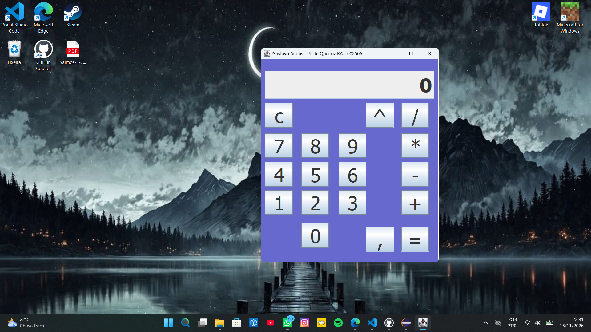
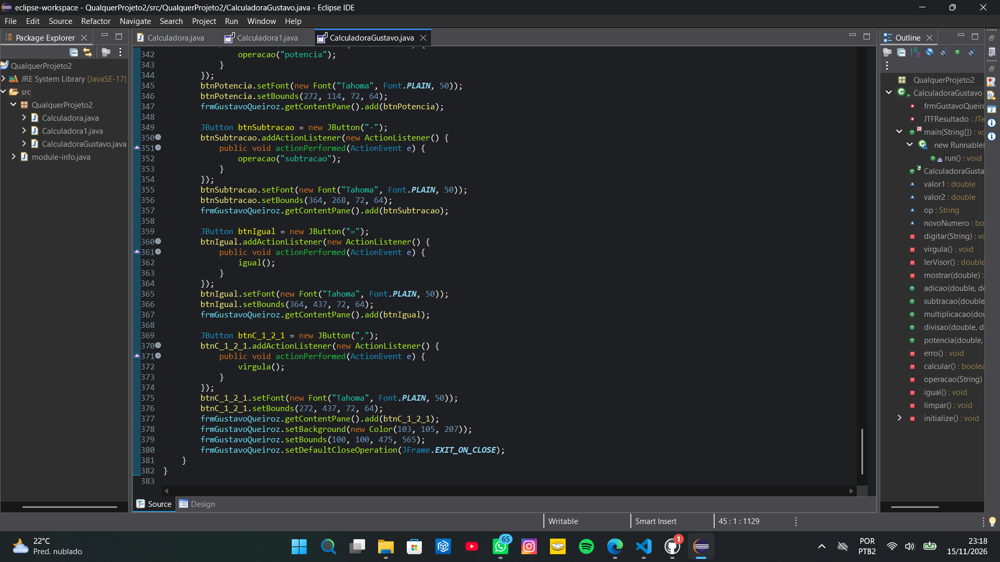
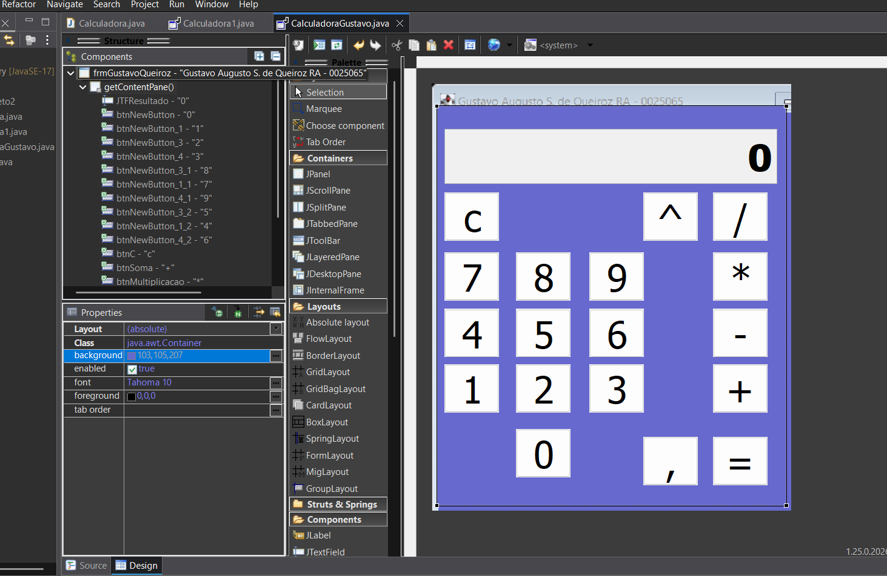

# POO-Calculadora

Atividade da faculdade desenvolvida em Java: uma calculadora gráfica usando Swing.

## Funcionalidades

- Operações de adição, subtração, multiplicação e divisão.
- Potenciação.
- Entrada de números decimais com vírgula.
- Limpeza da operação atual pelo botão `c`.

## Como compilar e executar

É necessário ter o JDK instalado. Na raiz do projeto, execute:

```sh
javac -d out QualquerProjeto2/CalculadoraGustavo.java
java -cp out QualquerProjeto2.CalculadoraGustavo
```

## Capturas de tela

Calculadora em execução:



Código-fonte aberto no Eclipse:



Layout da calculadora no Eclipse:


